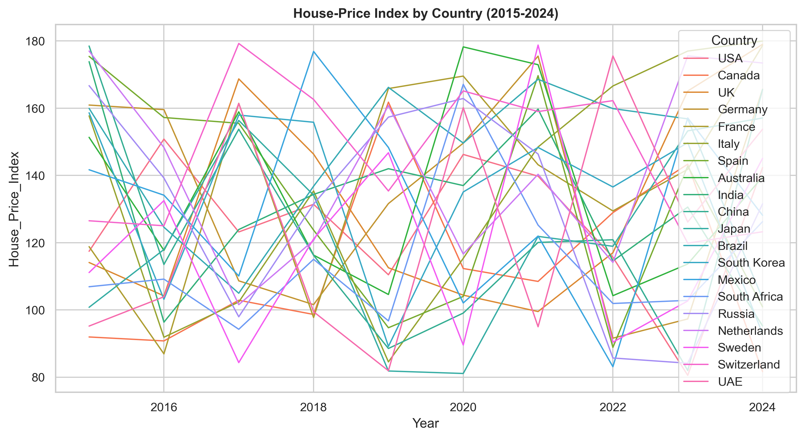
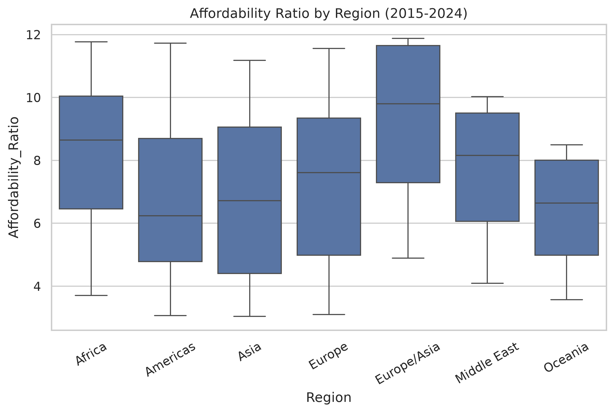
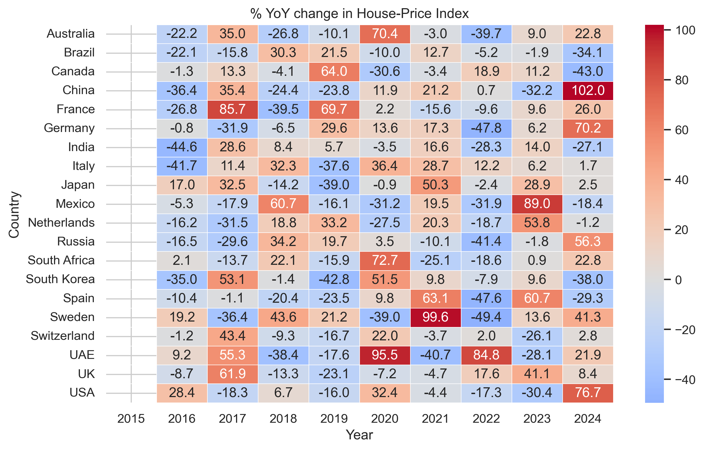

# Housing-Viz

[](https://github.com/lukahere007/housing-viz/actions/workflows/ci.yml)


A small plotting toolkit (`housing_viz.py`) for country-by-year panel data, demonstrated on the Kaggle
[*Global Housing Market Analysis 2015-2024*](https://www.kaggle.com/datasets/atharvasoundankar/global-housing-market-analysis-2015-2024)
dataset (20 countries x 10 years = 200 rows): spaghetti and small-multiple line charts, faceted bar charts,
a YoY heat-map, regional box-plots, correlation matrices and an animated Plotly bar race.

**The main finding is about the data itself: it does not behave like real housing data.** The values look like
independent random draws, so the charts are a demonstration of technique, not evidence about housing markets
in any country. Details below.

## About the data (read this first)

Real affordability ratios and price indices move slowly: this year's value is close to last year's, and some
countries are consistently more expensive than others. Running `hv.persistence_check()` on the 200
`Affordability_Ratio` values (recovered from the Plotly output saved in the original notebook, since Kaggle
could not be reached when this README was written) gives:

| Check | Result | What real data would show |
|---|---|---|
| Range | 3.04 to 11.88, spread roughly evenly | Skewed, country-specific levels |
| Median year-to-year autocorrelation within a country | **-0.17** (positive in only 5 of 20 countries) | Strongly positive (close to 1) |
| Median absolute change from one year to the next | 2.69 points | Small relative to the level |
| One-way ANOVA, do countries differ? | **p = 0.16** (no detectable country effect) | Large, clear differences |

The house-price index looks the same way in the figures: most countries swing up and down by tens of percent
every year with no trend ([YoY heat-map](figs/yoy_heatmap.png)). Treat the dataset as synthetic. Earlier
versions of this README drew country-level conclusions (e.g. "Germany & UK consistently least affordable",
"Japan HPI tracks inflation"); those have been removed because the data cannot support them.

## Figures

All PNGs in `figs/` are produced by `make_figures.py`. Figures 1-5 and 7 come from the author's original run on
the Kaggle data. Figure 6 was regenerated after fixing a bug (see below).

**HPI by country.** No country follows a trend; the lines cross constantly.



**Affordability by region.** Corrected version, with all 20 countries. Four regions contain a single
country, so their boxes are one country's ten years.



**YoY change in HPI.**



Other figures: [top-5 HPI change](figs/top5_growth.png), [affordability facets](figs/affordability_facets.png),
[smoothed HPI panel](figs/hpi_smoothed_panel.png), [Japan correlation matrix](figs/japan_corr.png)
(10 yearly points per coefficient, so it is mostly noise).

## Fixes in this version

- **Region box-plot dropped 3 of 20 countries.** The region map used `South_Korea` / `South_Africa`, but the data
  says `South Korea` / `South Africa`, and Mexico was missing. They silently became `NaN` and the "Africa" box never
  appeared. Now the map uses the dataset's names, and `region_boxplot` raises an error if any country is unmapped.
  Corrected regional medians: Africa 8.65, Americas 6.24, Asia 6.72, Europe 7.61, Europe/Asia (Russia only) 9.80,
  Middle East 8.16, Oceania 6.64.
- Removed hard-coded Windows paths (`sys.path.append(r"C:\Users\...")`); everything runs from the repo root.
- Merged the duplicated layout (`Housing_Data/`, a checkpoint copy and two near-identical notebooks, about 24 MB)
  into one module, one script and one small notebook.

## Repository layout

```
├── housing_viz.py              # plotting helpers + data loader + persistence_check()
├── make_figures.py             # regenerates every PNG in figs/
├── notebooks/
│   └── housing_viz_tour.ipynb  # walk-through of each plot (saved without outputs)
├── figs/                       # PNGs shown above
├── tests/                      # pytest smoke tests on a fake frame with the same schema
├── data/                       # put the Kaggle CSV here (git-ignored)
└── requirements.txt
```

## Run it

```bash
git clone https://github.com/lukahere007/housing-viz.git
cd housing-viz
python -m venv .venv && source .venv/bin/activate   # Windows: .venv\Scripts\activate
pip install -r requirements.txt

pytest                         # smoke tests, no data needed
python make_figures.py --html  # needs the data, see below
```

Data: either download the CSV from the Kaggle page into `data/`, or place a Kaggle API token in `~/.kaggle/kaggle.json`
and `kagglehub` downloads it on first use (cached in `~/.cache/kagglehub`).

## Limitations

- The notebook was not re-run against the real data for this version (Kaggle was unreachable). The code was
  checked by running the full notebook and `make_figures.py` on a fake dataset with the same columns.
- The dataset's documentation does not say how it was made. The "synthetic" conclusion comes from the checks
  above, not from the dataset author.

## License

MIT, see [LICENSE](LICENSE).
